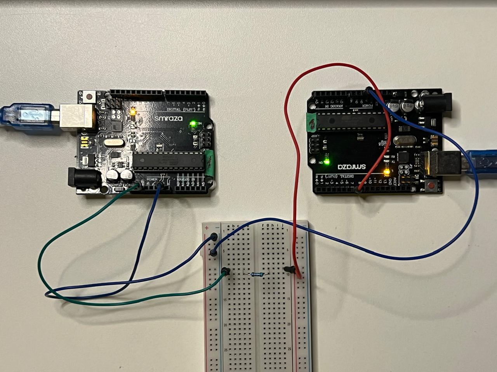

# arduino-fdir-fault-injection
An Arduino Uno R3 adaptation of a Python-controlled fault-injection and FDIR evaluation experiment.

# Arduino Uno R3 FDIR Fault-Injection Evaluator (Summarized Description)

A low-cost adaptation of the Delfi-PQ FDIR evaluation methodology using two Arduino Uno R3 boards and a Python-based test harness.

This project explores controlled bit-flip injection, data-integrity checks, failure detection, external hardware resets, and automated experiment logging.

**Current status:** The initial 100-trial fault-injection campaigns are complete. The secondary Arduino's hardware-reset path has been verified during startup testing. Controlled lockup recovery and broader SRAM experiments remain planned extensions.

## Inspiration

- [Delfi-PQ FDIR Evaluator](https://github.com/maGriffioen/Delfi-PQ_FDIR_Evaluator)
- [FDIR_PQ9](https://github.com/nchronas/FDIR_PQ9)

## Technology

- Arduino Uno R3 / ATmega328P
- C++ / Arduino firmware
- Python
- PySerial
- CSV-based experiment logging

## Key Adaptation

The original experiment targets a different microcontroller architecture. This adaptation uses a bounded 32-byte test buffer rather than assuming the original MSP432 memory addresses are valid on the Arduino Uno R3.

## Current Results

- 100/100 trials completed in Step 1.
- 100/100 trials completed in Step 2.
- 100 data faults detected and 100 test-buffer restorations verified in each campaign.
- No reset was needed during the Step 2 trials.
- The external reset path was verified separately during startup testing.

These are results from the current controlled test setup, not radiation-test results.

## Hardware Setup

Hardware: Two Arduino Uno R3-compatible boards (Smarza)
The experiment uses one board as the primary fault-injection controller and the second as an external reset controller.

## Planned Work

1. Test recovery from a deliberately induced software lockup.
2. Improve fault classifications and recovery-time measurements.
3. Define a safe, bounded SRAM experiment.
4. Expand automated test coverage and generate result plots.
5. Optionally implement autonomous heartbeat monitoring.

## Disclaimer

This is an educational fault-injection prototype. It does not simulate physical radiation exposure and is not flight-qualified spacecraft FDIR software.

# Arduino Uno R3 FDIR Fault-Injection Evaluator (Detailed Description)

## 1. Project Overview

This project adapts the methodology of the [Delfi-PQ FDIR Evaluator](https://github.com/maGriffioen/Delfi-PQ_FDIR_Evaluator) to a low-cost setup using two Arduino Uno R3 boards and a Python host.

The objective is to build a small, automated test environment for studying how a controller responds to controlled data faults, how those faults can be detected, and whether the system can recover after a failure.

The project preserves the original experiment's main idea:

1. Select a target memory location and bit.
2. Inject a controlled fault.
3. Observe the controller's behavior and data integrity.
4. Detect and classify the outcome.
5. Attempt recovery when needed.
6. Record results for analysis.

The experiment is inspired by spacecraft fault-tolerance testing, but it is **not a radiation experiment** and does not yet demonstrate a complete flight-ready FDIR system.

## 2. Background: What Is FDIR?

FDIR stands for **Fault Detection, Isolation, and Recovery**.

- **Fault detection:** Determine whether something has gone wrong.
- **Fault isolation:** Identify the affected component, data, or location.
- **Recovery:** Attempt to return the system to a safe, correct operating state.

In a spacecraft, a controller may receive incorrect data, stop responding, or behave unexpectedly because of hardware faults or radiation-induced effects.

One example is a single-event upset (SEU). An energetic particle can change the stored state of a memory cell, potentially changing a single bit from 0 to 1 or from 1 to 0. The resulting software behavior depends on what that bit represents.

Testing every possible failure in an actual radiation environment can be expensive and difficult to control. Fault injection offers a complementary method: deliberately introduce a known fault and observe what happens.

This project explores a simplified version of that methodology using Arduino hardware.

## 3. Inspiration and Adaptation

### Original references

- [Delfi-PQ FDIR Evaluator — maGriffioen](https://github.com/maGriffioen/Delfi-PQ_FDIR_Evaluator)
- [FDIR_PQ9 — nchronas](https://github.com/nchronas/FDIR_PQ9)

The FDIR Evaluator uses a Texas Instruments MSP432P401R development board as its primary controller, a second controller for resets, and Python software to automate fault-injection tests.

The broader FDIR_PQ9 repository describes the Delfi-PQ small-satellite testing environment and its use of controlled faults to evaluate spacecraft software.

### Adaptation to Arduino Uno R3

This project replaces the MSP432-based test setup with two Arduino Uno R3 boards.

The key adaptation is that the Uno R3 uses an ATmega328P microcontroller with only **2 KB of SRAM**. Its memory layout, architecture, and available resources differ from those of the MSP432.

Therefore, the original MSP432 memory addresses cannot be copied directly. The adapted experiment uses a small, explicitly defined 32-byte test buffer and obtains its actual address from the running Arduino.

The goal is not to reproduce the original hardware exactly. It is to preserve the core experimental method—controlled fault injection, observation, detection, recovery, and logging—within the Uno's limitations.

### Current limitations

- The test buffer is only 32 bytes; it does not represent all SRAM.
- Faults currently target the controlled buffer, not arbitrary SRAM addresses.
- The experiment does not reproduce the physical effects of radiation.
- The current reset controller responds to commands from Python; autonomous heartbeat monitoring has not been implemented.
- A successful reset does not automatically prove that corrupted data was recovered correctly.
- The Uno's limited SRAM and processing resources constrain how much instrumentation can be added.

## 4. System Architecture

The setup has three main components.

### A. Primary Arduino Uno R3 — test controller

The primary board runs the experiment firmware. It stores known test values, receives commands, moves a pointer within the test buffer, flips selected bits, reports data, and responds to integrity checks.

It is the device whose behavior is being evaluated.

### B. Secondary Arduino Uno R3 — reset controller

The secondary board is responsible for triggering a hardware reset on the primary.

Its digital pin 7 is connected to the primary's RESET pin through a 1 kΩ resistor. The boards also share a common ground.

The secondary receives a reset command from Python and briefly pulls the primary RESET line low. This lets the test harness restart the primary even if its main program stops responding.

At present, the secondary is a **command-driven reset controller**, not an autonomous watchdog.

### C. Python host — experiment coordinator

The Python program communicates with both boards over USB serial.

It coordinates commands, checks responses, determines whether faults were detected, verifies recovery, and writes the results to a CSV file.

Python acts as the experiment's external coordinator and data logger. It does not directly write arbitrary addresses in the Arduino's SRAM; the primary firmware performs the controlled buffer operations.

## 5. Current Hardware and Software

| Component | Role |
|---|---|
| Arduino Uno R3 #1, COM3 | Primary test controller |
| Arduino Uno R3 #2, COM8 | External reset controller |
| USB serial connection | Python-to-board communication |
| Digital pin 7 → 1 kΩ → RESET | Secondary-triggered primary reset |
| Common GND | Shared electrical reference |
| Arduino IDE | Compile and upload firmware |
| Python and PySerial | Automate trials and save results |

The Python program must use the correct COM ports. Close Arduino Serial Monitor windows before running Python, because another application holding a serial port can prevent access.

## 6. How the Current Primary Firmware Works

The primary firmware uses a small set of commands to expose controlled parts of its behavior to Python.

### The 32-byte experiment buffer

The firmware declares a 32-byte array called `experimentMemory`.

Each byte can store a value from 0 to 255. The firmware initializes each position with a known value:

`expectedData[i] = 42 + i`

The same value is copied into the experiment buffer.

The `expectedData` array acts as a reference for comparison. If a bit flip changes a value in `experimentMemory`, the evaluator can compare the result against the expected value.

This is similar to placing a known test pattern in memory and checking whether it remains correct after a fault.

### The pointer and index

The firmware maintains a pointer called `flipPointer` and an index called `pointerIndex`.

The index identifies which byte in the 32-byte buffer is selected. The pointer refers to that byte's address in SRAM.

The pointer allows the program to operate on the currently selected byte. The index makes it easier to check that the pointer is pointing where it should.

The `M,index` command selects a buffer position. The firmware rejects indices outside the buffer, helping prevent accidental access beyond the experiment's intended region.

The `INFO` command reports the buffer size and its actual start address on the running board. That address is useful for documenting the experiment, but the current injection commands use a buffer index rather than allowing Python to write arbitrary SRAM addresses.

### The bit-flip command

The `F,bit` command flips one selected bit of the currently selected byte.

Conceptually, the operation is:

`value = value XOR (1 << bit)`

XOR toggles a bit: 0 becomes 1, or 1 becomes 0. The other bits remain unchanged.

The firmware accepts bit positions 0 through 7 because a byte contains eight bits.

For example, if a byte contains `42`, its binary representation is `00101010`. Flipping bit 0 changes it to `00101011`, which is `43`.

This controlled operation imitates the *data-state change* associated with a single-bit fault. It does not recreate the particle interaction that might cause a real SEU.

### The set/restore command

The `S,value` command writes a selected value to the currently pointed-to byte.

The Python evaluator uses it to restore the expected value after a test. The program then reads the selected location again and verifies that the value matches the reference.

This is a simple form of test-data restoration. It is not yet a general-purpose recovery algorithm for an actual spacecraft subsystem.

### Pointer reporting

The `O` command reports the selected index, pointer address, current byte value, expected value, and whether the pointer matches the expected buffer location.

These checks help distinguish a data error from a pointer-selection problem.

### Test-string integrity

The `T` command checks a separate string, `Hello world`, against an expected version stored in program memory.

The evaluator records whether the string remains intact.

This gives the experiment another observable data-integrity check. However, the current bit-flip command targets the 32-byte experiment buffer, so a successful buffer injection does not necessarily corrupt the separate test string.

### Serial commands

The primary recognizes these commands:

| Command | Function |
|---|---|
| `P` | Ping the primary; a working controller replies `PONG` |
| `INFO` | Report buffer size and starting address |
| `M,index` | Select a byte in the experiment buffer |
| `F,bit` | Flip one bit in the selected byte |
| `S,value` | Write a value to the selected byte |
| `O` | Report pointer information and current/expected data |
| `T` | Check the integrity of the test string |

Commands end with a semicolon in the serial protocol, for example `M,4;`.

## 7. How the Reset Controller Works

The secondary Arduino accepts two commands:

- `P`: respond with `PONG`.
- `R`: trigger a hardware reset on the primary.

When it receives `R`, the secondary reports that the reset is starting, pulls digital pin 7 low for 250 milliseconds, and then returns the pin high.

The low pulse on the primary's RESET line restarts the primary microcontroller.

This is useful because the reset mechanism is physically separate from the primary's program. If the primary stops executing its normal code, the secondary can still reset it as long as the secondary and reset connection remain functional.

In the current design, Python decides when to issue the reset command. The secondary does not independently monitor a heartbeat or decide on its own that the primary has failed.

## 8. How the Python Evaluator Works

The Python script is the experiment's coordinator.

### Step 1: Open the serial connections

Python opens COM3 for the primary and COM8 for the reset controller at 9600 baud.

It waits briefly for the boards to initialize, clears stale serial input, and checks that the reset controller responds.

Opening an Arduino serial connection can itself reset the board. The script allows time for startup before sending its commands.

### Step 2: Check the primary and test the reset path

Python pings the primary. If the primary does not respond, it attempts to reset it using the secondary.

The optional startup reset test then deliberately triggers the secondary's reset pulse and checks that the primary responds again.

This verifies that the reset hardware and serial command path work under the tested conditions.

### Step 3: Read the buffer information

Python requests `INFO` and reads the buffer size and actual start address from the primary.

It uses the reported buffer size to keep the test indices inside the 32-byte buffer.

### Step 4: Select the location and bit

For each trial, the script calculates an index and a bit position:

- `index = (trial * 7) % buffer_size`
- `bit = (trial * 3) % 8`

These formulas produce a repeatable test sequence. They are deterministic, not random.

Because the index and bit sequences repeat, 100 trials do not represent 100 unique combinations. The sequence is useful for checking that automation works, but broader coverage should be a later improvement.

### Step 5: Inject the fault

Python sends the move command to select the buffer position, then sends the flip command to toggle the chosen bit.

The primary reports the selected index, bit number, and before/after values.

Python compares the resulting value against the expected value to determine whether the data fault is detected.

### Step 6: Check integrity and responsiveness

Python asks the primary to check the test string and sends a ping to see whether the controller is still responding.

If a command response is missing or the primary fails to respond, the script records a reset attempt and asks the secondary to reset the primary.

It then checks whether the primary responds after the reset.

### Step 7: Restore and verify the test value

For normal data-fault trials, Python sends the expected value to the selected buffer byte.

It then requests a pointer/data report and checks whether the byte has returned to the expected value and the pointer check passes.

This is the current test's recovery verification for the controlled buffer.

### Step 8: Classify and save results

Each trial receives a classification, such as:

- `DATA_FAULT_RECOVERED`
- `FAULT_NOT_DETECTED`
- `DATA_FAULT_RECOVERY_FAILED`
- `TEST_STRING_CORRUPTION`
- `RESET_RECOVERED`
- `RESET_FAILED`

The evaluator saves trial-level data to a CSV file, including the selected index and bit, detection and recovery indicators, reset attempts, and classification.

The CSV enables later analysis without needing to manually copy results from the serial output.

## 9. Current Test Results

### Step 1 — Baseline fault-injection campaign

The first automated campaign completed 100 out of 100 trials.

Reported results:

- Detected data faults: 100
- Verified data recoveries: 100
- Trials recorded: 100/100

### Step 2 — Campaign with the secondary reset controller

The second campaign also completed 100 out of 100 trials.

Reported results:

- Detected data faults: 100
- Verified data recoveries: 100
- Reset attempts during trials: 0
- Successful resets during trials: 0

The startup reset test was successful: the secondary triggered the primary's hardware reset, and the primary responded to a subsequent ping.

No reset was required during the 100 fault-injection trials because the selected buffer bit flips did not make the primary stop responding.

### Interpretation

These results demonstrate that the serial command sequence, controlled buffer bit flips, detection checks, restoration checks, CSV logging, and startup reset path worked in the tested setup.

They do **not** demonstrate that the system can recover from every possible fault, that all SRAM locations are safe to test, or that a spacecraft would survive radiation exposure.

The next step is to test the reset mechanism under a deliberately induced loss of responsiveness.

## 10. Next Steps

The project is paused after Step 2. The following roadmap is planned for future work.

### Step 3 — Controlled lockup and external recovery

Add an explicit test command to the primary firmware that reports that a lockup simulation is beginning and then deliberately stops processing normal commands.

Python will:

1. Send the lockup-test command.
2. Confirm that the test began.
3. Attempt to ping the primary and confirm that it no longer responds.
4. Command the secondary to pulse the primary RESET line.
5. Wait for the primary to restart.
6. Ping the primary again to verify that it responds.
7. Record whether recovery succeeded and how long recovery took.

This is a controlled software-induced lockup, not a real radiation-induced failure. It tests the external reset and recovery sequence.

The lockup command should be used only in an explicitly controlled test. It should not be part of the normal fault-injection campaign unless the evaluator is prepared to recover and reinitialize the board.

### Step 4 — Strengthen detection and classifications

Improve the evaluator to distinguish among:

- Correct data
- Detected data corruption
- Undetected data corruption
- Pointer or selection errors
- Test-string corruption
- Missing or malformed command responses
- Primary unresponsive
- Reset attempted and successful
- Reset attempted but unsuccessful
- Data restored correctly after recovery
- Unexpected failures and false alarms

Record recovery time and whether the primary returns to the correct operating state.

### Step 5 — Define a bounded SRAM experiment

Keep the current buffer as the safe baseline.

If expanding beyond it, first define and validate a reserved memory region and a method for ensuring that test addresses cannot overwrite the stack, serial buffers, or other critical runtime state.

The original MSP432 memory ranges must not be reused on the Uno. Any broader memory test must be designed around the ATmega328P memory map and the Uno's limited SRAM.

### Step 6 — Expand the automated campaign

After validating the lockup-recovery sequence and classification logic:

- Increase the number of trials.
- Expand coverage of byte indices and bit positions.
- Record exact test conditions and outcomes.
- Keep the injection sequence reproducible, and document whether it is deterministic or randomized.
- Generate plots showing fault outcomes by index, bit position, and fault category.
- Compare detection, recovery, and end-to-end success across test campaigns.

### Step 7 — Optional autonomous watchdog

As a later extension, the secondary controller could monitor a heartbeat from the primary and trigger a reset when the heartbeat is missing for a defined interval.

This would make the reset controller more autonomous. It is separate from the current command-driven design and should be tested only after the controlled lockup-recovery test is working reliably.

## 11. Evaluation Metrics

For a campaign with known injected faults, calculate:

**Detection rate**

`detected faults / total injected faults`

This measures how many injected faults were identified by the evaluator's detection criteria.

**Recovery rate**

`successfully recovered detected faults / detected faults`

This measures recovery among faults that were detected. Define recovery success carefully before running the campaign.

**End-to-end success rate**

`faults correctly detected and successfully recovered / total injected faults`

This is the fraction of all injected faults that completed both detection and recovery successfully.

Also record:

- False alarms
- Unexpected crashes
- Missing command responses
- Reset attempts and reset success
- Recovery time
- Whether data is correct after recovery
- Whether the primary returns to its expected operating state

A reset alone does not prove that the data was recovered correctly. The evaluator must check the state after reset or recovery.

For example, if 100 faults are injected, 95 are detected, and 92 are correctly recovered, the detection rate is 95%, the recovery rate is 92/95 (about 96.8%), and the end-to-end success rate is 92%. These are illustrative numbers, not this project's results.

## 12. What This Project Represents in Industry

This project demonstrates a simplified form of **fault-injection testing and recovery validation**, techniques used when engineers need to understand how embedded systems behave under abnormal conditions.

In a spacecraft or other safety-critical embedded system, engineers may use controlled tests to evaluate:

- Whether corrupted data is detected.
- Whether a controller remains responsive.
- Whether a recovery mechanism can restart an unresponsive controller.
- Whether the system returns to a known-good state.
- How consistently the system responds across repeated tests.
- Which memory locations or fault types are associated with failures.

The two-controller design represents a simplified separation between a primary controller and an external recovery mechanism. The Python host represents a ground-test or engineering-support tool that automates experiments and records telemetry.

The current prototype is an educational test platform, not flight-qualified FDIR software. Its value is that it applies a repeatable experimental method to accessible hardware while documenting the limitations.

## 13. Development Notes

- **Current stage:** Step 2 completed; project paused.
- **Primary port:** COM3.
- **Reset-controller port:** COM8.
- **Serial baud rate:** 9600.
- **Test buffer:** 32 bytes.
- **Initial campaign size:** 100 trials.
- **Python script:** `run_experiment.py`.
- **CSV output:** `fdir_results_step1.csv` and `fdir_results_step2.csv`.
- **Next planned task:** controlled lockup simulation, external reset, and recovery-time measurement.

The project was developed with assistance from ChatGPT for code drafting, explanation, and debugging. Relevant conversation: https://chatgpt.com/c/6ada6dbe-090c-83e9-b9f7-31f312769007.
